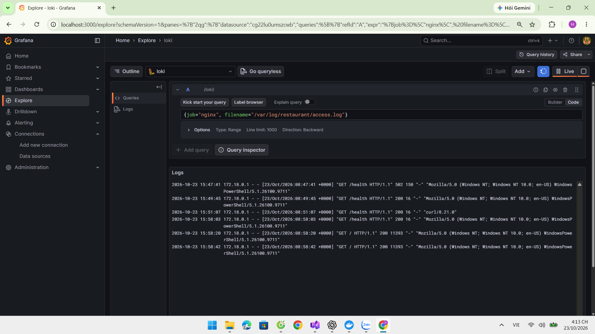
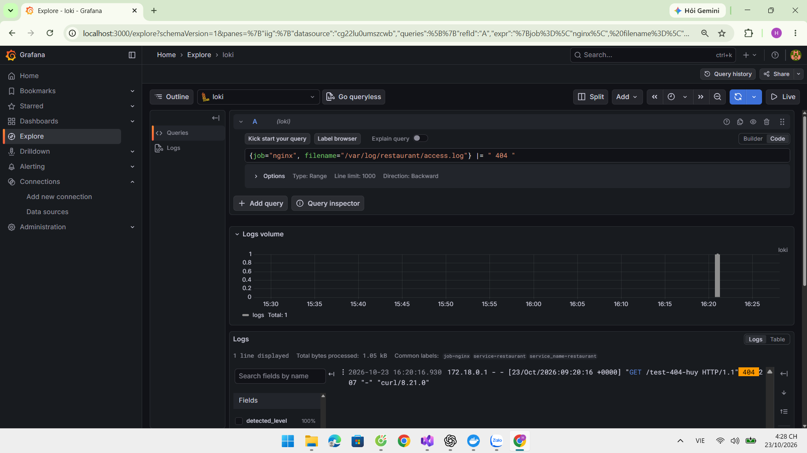
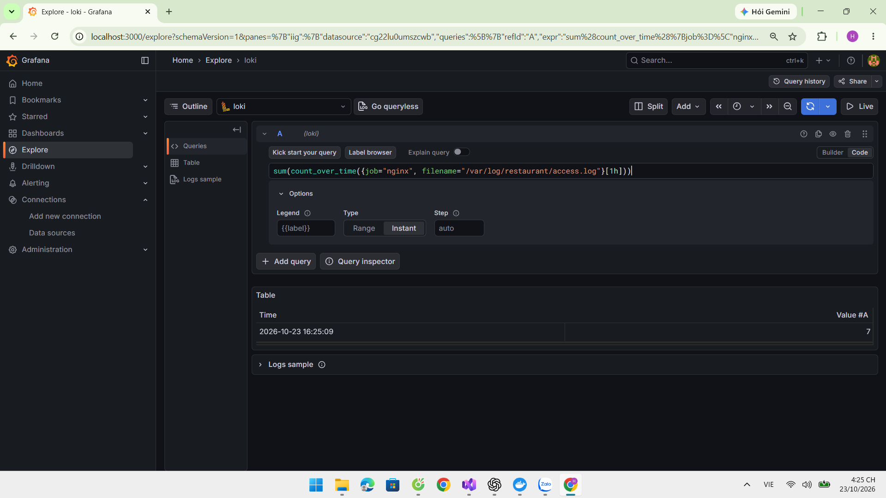

# DTC245200348 — Restaurant DevOps

Hệ thống quản lý món ăn, bàn ăn và đơn hàng bằng Python/Flask, PostgreSQL và Docker Compose.

## Yêu cầu và phạm vi
- Docker Desktop dùng Linux containers; Docker Compose >= 2.24.4 (hỗ trợ !override).
- PowerShell, Git; Docker Engine đang chạy.
- Đây là bài thực hành chạy trên máy cá nhân. Website chưa có đăng nhập/CSRF; không công khai lên Internet.
- cAdvisor dùng privileged để đọc thông tin container; đây là ngoại lệ giám sát, không phải biện pháp hardening.
- Promtail được giữ theo yêu cầu đề bài; đã hết hỗ trợ, không dùng làm lựa chọn mới cho production.

## Cài mới
```powershell
git clone https://github.com/dinhhuy06/DTC245200348-Restaurant-DevOps.git
cd DTC245200348-Restaurant-DevOps
Copy-Item .env.example .env
notepad .env
```
Điền DB_NAME, DB_USER, DB_PASSWORD, PGADMIN_EMAIL, PGADMIN_PASSWORD,
POSTGRES_EXPORTER_PASSWORD, GRAFANA_PASSWORD và APP_DB_PASSWORD.
Mỗi mật khẩu dùng giá trị riêng, tối thiểu 16 ký tự ngẫu nhiên. Không commit .env.
Giữ DB_USER=restaurant_owner; đây là tài khoản quản trị khởi tạo.
App dùng restaurant_app, không dùng tài khoản quản trị.

Khởi động cả 5 file, bao gồm hardening:
```powershell
docker compose -f compose.yaml -f compose.override.yaml -f compose.monitoring.yaml -f compose.logging.yaml -f compose.hardening.yaml config --quiet
docker compose -f compose.yaml -f compose.override.yaml -f compose.monitoring.yaml -f compose.logging.yaml -f compose.hardening.yaml up -d --build
```
postgres khởi tạo database/init.sql trên volume mới. Dịch vụ db-init chạy database/roles.sql
để tạo/cập nhật mật khẩu restaurant_app và restaurant_monitor, cấp quyền app theo 4 bảng,
cấp pg_monitor cho exporter. db-init kết thúc mã 0 là bình thường. Script này cũng dùng được
với volume cũ; không cần xóa database.

Nếu đã chạy bản cũ: giữ .env và volume, chỉ thêm APP_DB_PASSWORD rồi dùng đủ 5 file trên.
Không dùng docker compose down -v vì sẽ xóa volume.

## Địa chỉ
| Thành phần | URL |
|---|---|
| Website qua Nginx | http://localhost:8080 |
| pgAdmin | http://localhost:5050 |
| Prometheus | http://localhost:9090 |
| Prometheus Targets | http://localhost:9090/targets |
| Grafana | http://localhost:3000 |

App:8000, postgres:5432, loki:3100 và exporter không mở cổng ra host trong cấu hình đủ 5 file.
Các cổng quản trị chỉ bind 127.0.0.1.

## PostgreSQL và pgAdmin
Đăng nhập pgAdmin bằng PGADMIN_EMAIL/PGADMIN_PASSWORD. Register Server:
- Name: Restaurant
- Host: postgres
- Port: 5432
- Maintenance database: giá trị DB_NAME (mặc định restaurant)
- Username/password: DB_USER/DB_PASSWORD từ .env, chỉ dùng để quản trị.
Mở Schemas → public → Tables. Kiểm tra dishes, restaurant_tables, orders, order_items.
Xác nhận dữ liệu tạo từ website xuất hiện trong các bảng.

## Website và kiểm thử chức năng
1. Thêm món thử có giá 12.000; sửa giá thành 15.000.
2. Thêm bàn thử; sửa tên; tạo đơn trên bàn.
3. Thêm món số lượng 2: tổng phải là 30.000; đổi số lượng 3: tổng 45.000.
4. Không cho tạo đơn đang mở thứ hai trên cùng bàn.
5. Thanh toán đơn: trạng thái paid, bàn rảnh; không cho thêm/sửa món của đơn đã thanh toán.
6. Món/bàn đã có lịch sử không xóa được; thử xóa món/bàn mới chưa dùng.
7. Kiểm tra lại pgAdmin; dừng/khởi động container và xác nhận dữ liệu vẫn tồn tại.
Không xóa dữ liệu học tập có sẵn để tạo minh chứng.

## Giám sát
Bốn job prometheus, nginx, postgres, containers cần UP.
Grafana: admin / GRAFANA_PASSWORD (với volume đã khởi tạo, dùng mật khẩu đang có).
Khi chạy compose.hardening.yaml, provisioning tự tạo:
- prometheus: http://prometheus:9090, UID dg22f31bendvke
- loki: http://loki:3100 (giữ UID tự động của datasource theo tên)
- dashboard trong folder Restaurant từ grafana/restaurant-dashboard.json.

Nếu Grafana cũ có datasource cùng tên nhưng UID khác, kiểm tra và xử lý bản trùng trước;
không xóa volume để sửa lỗi. Các panel Prometheus tham chiếu UID cố định phía trên.
Dashboard provisioned có thể chỉnh trong UI, nhưng cần xuất JSON về file để giữ sửa đổi.

Metrics:
```promql
pg_up
nginx_up
rate(nginx_http_requests_total[1m])
sum by (name) (container_memory_working_set_bytes{job="containers",image!="",container_label_com_docker_compose_project="restaurant-devops"}) / 1024 / 1024
100 * sum by (name) (rate(container_cpu_usage_seconds_total{job="containers",image!="",container_label_com_docker_compose_project="restaurant-devops"}[2m]))
```
CPU 100% là một lõi; có thể vượt 100% nếu dùng nhiều lõi.

## Logging và LogQL
Nginx ghi file vào volume nginx_logs; Promtail đọc read-only và đẩy tới Loki.
Chọn datasource loki trong Explore. Chạy bằng Shift+Enter; không dùng Live cho truy vấn số liệu.

### 1. Access log — Type Range
```logql
{job="nginx", filename="/var/log/restaurant/access.log"}
```


### 2. HTTP 404 — Type Range
Tạo request:
```powershell
curl.exe -s -o NUL -w "%{http_code}" http://localhost:8080/khong-ton-tai-test
```
```logql
{job="nginx", filename="/var/log/restaurant/access.log"} |= "\" 404 "
```


### 3. Đếm request trong một giờ — Type Instant
```logql
sum(count_over_time({job="nginx", filename="/var/log/restaurant/access.log"}[1h]))
```


Số 22 trong ảnh là kết quả tại thời điểm chụp, không phải giá trị cố định.
File truy vấn: loki/queries.logql. Khi No data: chọn thời gian tương đối tới now,
kiểm tra access log trong cùng khoảng thời gian và log Promtail; không coi No data là 0.

## Hardening và cách chứng minh
| Biện pháp | Cấu hình / bằng chứng |
|---|---|
| App non-root | USER appuser, UID 10001 trong app/Dockerfile; kiểm tra id |
| Chặn tăng quyền | app.security_opt: no-new-privileges:true |
| Bỏ Linux capabilities | app.cap_drop: ALL |
| App filesystem chỉ đọc | read_only: true, /tmp dùng tmpfs giới hạn 64 MiB |
| Tách mạng DB | database.internal: true; postgres chỉ nối mạng database |
| Quyền DB tối thiểu | restaurant_app không superuser/createdb/createrole, chỉ DML và sequence |
| Giới hạn cổng | quản trị bind localhost; bỏ published port 8000 |
| Nginx headers | nosniff, SAMEORIGIN, Referrer-Policy; server_tokens off |
| Bí mật | .env bị gitignore; chỉ .env.example chứa giá trị mẫu |

Exporter có tài khoản restaurant_monitor riêng. pgAdmin và postgres-exporter là cầu nối
quản trị/giám sát giữa hai mạng; không khẳng định DB cách ly khỏi các dịch vụ này.
Nginx dùng security headers theo lựa chọn cho phép của đề, chưa cấu hình HTTPS.

Chạy bộ kiểm tra đọc trạng thái:
```powershell
powershell -NoProfile -ExecutionPolicy Bypass -File scripts/verify.ps1
```
Đọc CHECK-RESULTS.md để phân biệt kiểm tra đã chạy với kiểm tra runtime còn chờ.

## Vận hành
Luôn dùng đủ 5 file. Lệnh dừng giữ dữ liệu:
```powershell
docker compose -f compose.yaml -f compose.override.yaml -f compose.monitoring.yaml -f compose.logging.yaml -f compose.hardening.yaml stop
```
Kiểm tra:
```powershell
docker compose -f compose.yaml -f compose.override.yaml -f compose.monitoring.yaml -f compose.logging.yaml -f compose.hardening.yaml ps -a
docker compose -f compose.yaml -f compose.override.yaml -f compose.monitoring.yaml -f compose.logging.yaml -f compose.hardening.yaml logs --tail 50 db-init app grafana loki promtail
```
Không chụp/in toàn bộ docker compose config hoặc docker inspect vì có thể lộ mật khẩu.

## Hồ sơ nộp bài
- Source, Compose, Nginx, Prometheus, Loki, Promtail và Grafana JSON.
- Ít nhất 3 commit có ý nghĩa; giữ lịch sử triển khai, monitoring, logging.
- Báo cáo >=10 trang: bìa, kiến trúc, triển khai, monitoring, logging, hardening, kết quả, kết luận.
- Ảnh website/pgAdmin/Targets/dashboard/hardening và ba truy vấn LogQL.
- Demo thao tác website, dữ liệu DB, metrics, truy vấn log và kiểm chứng bảo mật.
